# Arquitectura: DAG Script Builder

Diagrama de conexión del componente de este repositorio con la
arquitectura general. El **DAG Script Builder** traduce la
definición del pipeline a un artefacto ejecutable; no procesa los datos durante
la compilación y no es el worker que ejecuta el pipeline.

```mermaid
flowchart LR
    subgraph USERS["Usuarios y definición del pipeline"]
        USER["Usuario"]
        UI["UI de integración<br/>Editor visual del DAG"]
        USER --> UI
    end

    subgraph CONTROL["Plano de control de la plataforma"]
        API["API de pipelines"]
        API_NODES["Endpoint nodes"]
        API_EDGES["Endpoint edges"]
        API_OPERATIONS["Endpoint operations"]
        META_DB[("DB de metadatos<br/>pipeline y configuración")]
        SCHEDULER["Scheduler"]
        TEMPORAL["Temporal worker"]
        EXEC_MANAGER["DataIntegration /<br/>Execution Manager"]

        UI -->|"guardar / consultar DAG"| API
        API --> API_NODES
        API --> API_EDGES
        API --> API_OPERATIONS
        API <--> META_DB
        SCHEDULER --> TEMPORAL
        TEMPORAL -->|"solicitar ejecución"| EXEC_MANAGER
    end

    subgraph BUILDER["DAG Script Builder — este repositorio"]
        CLEAN["pipeline_clean<br/>normalizar nodes, edges y operations"]
        VALIDATE["IR + validación<br/>operaciones, parámetros y puertos"]
        TOPOLOGY["Validación topológica<br/>y orden de ejecución"]
        EMIT["Emitter por framework<br/>pandas · Polars · PyArrow · PySpark"]
        ARTIFACT["Artefacto standalone<br/>main.py + manifest.json<br/>[+ pipeline.ipynb]"]

        API_NODES --> CLEAN
        API_EDGES --> CLEAN
        API_OPERATIONS --> CLEAN
        CLEAN --> VALIDATE --> TOPOLOGY --> EMIT --> ARTIFACT
    end

    subgraph SHARED["Publicación y mensajería"]
        ARTIFACT_STORE[("Artifact Store<br/>PVC / S3 / almacenamiento aprobado")]
        REQUEST["Execution Request<br/>execution_id · manifest URI/hash<br/>parameters · datasources"]
        KAFKA_EXEC[("Kafka<br/>pipeline.executions")]
        KAFKA_EVENTS[("Kafka<br/>pipeline.events")]

        ARTIFACT -->|"publicar artefactos"| ARTIFACT_STORE
        EXEC_MANAGER -->|"crear solicitud con URI y parámetros"| REQUEST
        REQUEST -->|"publicar"| KAFKA_EXEC
    end

    subgraph RUNTIME["Cluster Kubernetes — ejecución aislada"]
        DISPATCHER["Dispatcher<br/>valida manifest y perfil"]
        JOB["Kubernetes Job<br/>imagen aprobada por perfil"]
        LAUNCHER["Worker launcher<br/>verifica hashes y ejecuta"]
        subgraph PROFILES["Imágenes de runtime"]
            PY_PANDAS["Python + pandas"]
            PY_POLARS["Python + Polars"]
            PY_ARROW["Python + PyArrow"]
            PY_SPARK["PySpark / spark-submit"]
        end
        DATA[("Datasets y resultados<br/>volúmenes / object storage")]

        KAFKA_EXEC -->|"consumir request"| DISPATCHER
        DISPATCHER -->|"resolver perfil y preparar Job"| JOB
        JOB --> LAUNCHER
        LAUNCHER -->|"seleccionar según manifest"| PY_PANDAS
        LAUNCHER -->|"seleccionar según manifest"| PY_POLARS
        LAUNCHER -->|"seleccionar según manifest"| PY_ARROW
        LAUNCHER -->|"seleccionar según manifest"| PY_SPARK
        ARTIFACT_STORE -.->|"montar / descargar artefacto"| LAUNCHER
        PY_PANDAS <--> DATA
        PY_POLARS <--> DATA
        PY_ARROW <--> DATA
        PY_SPARK <--> DATA
    end

    subgraph OBSERVABILITY["Estado de ejecución"]
        MONITOR["DataIntegration /<br/>Execution Manager"]
        UI_STATUS["Estado visible en UI"]
        KAFKA_EVENTS --> MONITOR --> UI_STATUS
        UI_STATUS --> UI
    end

    LAUNCHER -.->|"started / succeeded / failed"| KAFKA_EVENTS

    classDef implemented fill:#e8f5e9,stroke:#2e7d32,color:#1b5e20;
    classDef external fill:#eaf3ff,stroke:#1565c0,color:#0d47a1;
    classDef prepared fill:#fff3e0,stroke:#ef6c00,color:#e65100;
    class CLEAN,VALIDATE,TOPOLOGY,EMIT,ARTIFACT,REQUEST,DISPATCHER,LAUNCHER implemented;
    class USER,UI,API,API_NODES,API_EDGES,API_OPERATIONS,META_DB,SCHEDULER,TEMPORAL,EXEC_MANAGER,ARTIFACT_STORE,KAFKA_EXEC,KAFKA_EVENTS,JOB,PY_PANDAS,PY_POLARS,PY_ARROW,PY_SPARK,DATA,MONITOR,UI_STATUS external;
    class BUILDER prepared;
```

## Flujo de datos y responsabilidades

1. La UI guarda el DAG mediante la API. El builder consume las respuestas de
   `nodes`, `edges` y `operations`; en este repositorio esos datos se entregan
   como JSON y no se realizan llamadas HTTP a la API.
2. `pipeline_clean` normaliza la definición. El IR valida contratos y la
   topología determina el orden. El emitter produce un script autónomo para el
   framework elegido y su manifest.
3. El artefacto se publica en almacenamiento accesible por el worker. Una
   solicitud de ejecución referencia el manifest y contiene parámetros y
   ubicaciones de datasources; no contiene código arbitrario.
4. Kafka entrega la solicitud al dispatcher. Este valida el artefacto y asigna
   un perfil de runtime aprobado antes de preparar un Kubernetes Job.
5. El launcher del Job verifica los hashes y ejecuta el script con el runtime
   de la imagen. El propio script contiene las operaciones requeridas; el worker
   no necesita el catálogo del builder.
6. El worker publica eventos de estado para que el plano de control actualice
   la ejecución y la UI.

## Estado de integración

- **Implementado en este proyecto:** normalización/compilación, manifest,
  creación local de solicitudes, preparación de Jobs, launcher con verificación
  de integridad y adaptadores Kafka opcionales.
- **Preparado, no conectado aquí:** publicación remota de artefactos,
  credenciales/configuración de Kafka y envío real de Jobs a Kubernetes. La
  integración con Kubernetes requiere proporcionar el callback de envío y
  adaptar almacenamiento, montajes y perfiles al cluster.
- **Responsabilidad de la plataforma:** API/UI, persistencia del DAG, scheduler,
  políticas de reintento/DLQ, imágenes aprobadas, acceso a datos y observabilidad.

Las flechas discontinuas marcan los límites de integración que dependen del
despliegue. Importar o usar el builder no inicia conexiones con Kafka ni con
Kubernetes.
