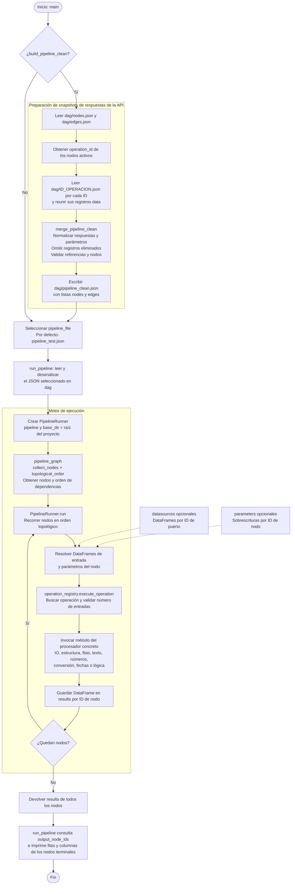
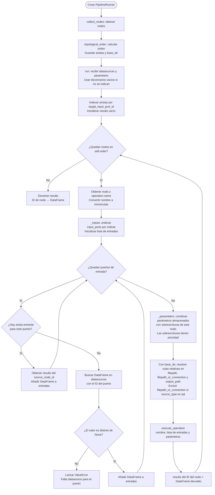
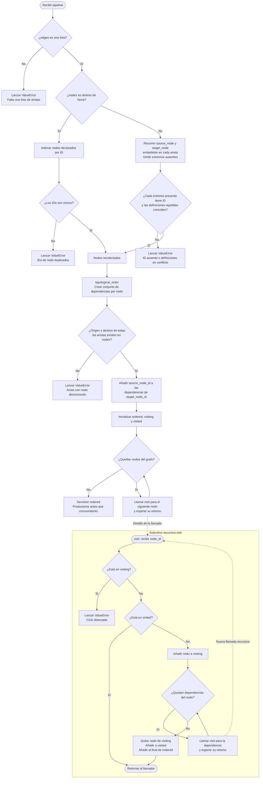
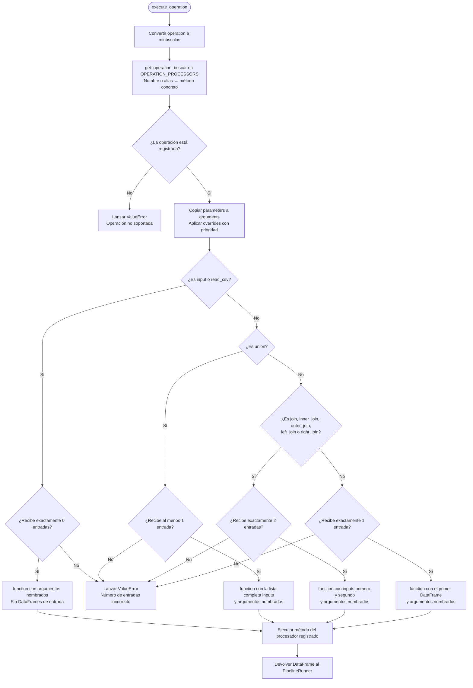

# Flujo de ejecución del pipeline

Este documento describe el funcionamiento actual del motor mediante cuatro diagramas Mermaid.
Los JSON de la carpeta [dag](dag) son snapshots de respuestas de la API: el programa no hace solicitudes HTTP.

## 1. Flujo general: respuestas de la API → preparación → ejecución

Referencias: [main.py](main.py), [pipeline_clean.py](engine/core/pipeline_clean.py), [pipeline_graph.py](engine/core/pipeline_graph.py), [pipeline_runner.py](engine/core/pipeline_runner.py) y [operation_registry.py](engine/core/operation_registry.py).

**Importante:** generar el pipeline limpio y elegir el pipeline que se ejecuta son pasos independientes. Por defecto, `main` genera [dag/pipeline_clean.json](dag/pipeline_clean.json), pero ejecuta [dag/pipeline_test.json](dag/pipeline_test.json). Para ejecutar el generado, se debe seleccionar `pipeline_file="pipeline_clean.json"` al invocar `main`.

La limpieza conserva las operaciones y los parámetros declarados; no inventa la configuración de los orígenes de datos. Los errores de preparación, grafo o ejecución se propagan y detienen el flujo.

## 2. PipelineRunner: resolver entradas, parámetros y resultados

Referencia: [pipeline_runner.py](engine/core/pipeline_runner.py).

- `run` ejecuta todos los nodos, incluidos los aislados; no solamente los terminales.
- Las entradas se ordenan por `ordinal`, lo que determina, por ejemplo, el lado izquierdo y derecho de un join.
- `output_node_ids` devuelve los IDs de nodos sin consumidores posteriores.
- `datasource_port_ids` devuelve los IDs ordenados de los puertos sin arista entrante.
- El runner no lee los snapshots ni limpia sus respuestas: recibe el diccionario del pipeline ya cargado.

## 3. PipelineGraph: recolectar nodos y ordenar dependencias

Referencia: [pipeline_graph.py](engine/core/pipeline_graph.py).

`visiting` representa la rama recursiva activa y permite detectar ciclos; `visited` evita procesar dos veces un nodo. No se garantiza un único orden entre nodos independientes: la garantía es que cada productor se ejecuta antes que sus consumidores.

## 4. OperationRegistry: seleccionar y ejecutar el procesador

Referencia: [operation_registry.py](engine/core/operation_registry.py).

El registro adapta los argumentos, pero no implementa las transformaciones: estas viven en los procesadores. Algunos nombres son alias del mismo método; otros usan `partial` para fijar argumentos, como el tipo de join o la operación lógica.

**Validación de `union`:** el registro admite una o más entradas; el procesador puede imponer validaciones adicionales. Los errores del procesador se propagan al runner sin capturarse en este flujo.
