# Arquitectura: DAG Script Builder

Diagrama de conexión del componente de este repositorio con la arquitectura
general. El **DAG Script Builder** (`engine.codegen`) se ubica como módulo dentro
de DataIntegration/Manager. El paquete `engine.dispatch` aporta contratos y
adaptadores reutilizables para la integración con Kafka y Kubernetes; no es por
sí mismo el servicio Job Dispatcher.

La captura de endpoints y el paso API → cleaner → builder requieren integración
del caller: este repositorio no realiza llamadas HTTP ni ejecuta
`merge_pipeline_clean` automáticamente desde la CLI. `Dispatcher.prepare()`
crea un Job spec, pero la integración con Kubernetes debe someterlo mediante un
callback externo.

```mermaid
flowchart LR
    subgraph USERS["Usuarios y definición del pipeline"]
        USER["Usuario"]
        UI["UI de integración<br/>Editor visual del DAG"]
        USER -->|"diseña DAG"| UI
    end

    subgraph MANAGER["Servidor — Manager / DataIntegration"]
        API["API de pipelines"]
        API_NODES["Endpoint nodes"]
        API_EDGES["Endpoint edges"]
        API_OPERATIONS["Endpoint operations"]
        DATA_INTEGRATION["DataIntegration<br/>coordina pipeline y ejecución"]
        META_DB[("DB<br/>metadatos del pipeline")]
        SCHEDULER["Scheduler"]
        TEMPORAL["Temporal worker"]
        EXEC_MANAGER["Execution Manager"]
        API_RESPONSE["Respuestas JSON<br/>nodes + edges + operations"]

        subgraph BUILDER["DAG Script Builder · engine.codegen"]
            CLEAN["pipeline_clean<br/>normalizar nodes, edges, operations"]
            VALIDATE["IR + validación"]
            TOPOLOGY["Validación topológica<br/>orden de nodos"]
            EMIT["Emitter<br/>pandas · Polars"]
            ARTIFACT["Artefacto ejecutable<br/>main.py + manifest.json"]
            CLEAN -->|"pipeline normalizado"| VALIDATE
            VALIDATE -->|"plan validado"| TOPOLOGY
            TOPOLOGY -->|"plan ordenado"| EMIT
            EMIT -->|"genera"| ARTIFACT
        end

        UI -->|"HTTPS REST · crear/editar DAG"| API
        API -->|"expone"| API_NODES
        API -->|"expone"| API_EDGES
        API -->|"expone"| API_OPERATIONS
        API <-->|"lee/escribe metadatos"| META_DB
        API_NODES -->|"GET response"| API_RESPONSE
        API_EDGES -->|"GET response"| API_RESPONSE
        API_OPERATIONS -->|"GET response"| API_RESPONSE
        API_RESPONSE -->|"entrega pipeline JSON"| DATA_INTEGRATION
        DATA_INTEGRATION -->|"invoca compile(pipeline, target)"| CLEAN
        SCHEDULER -->|"dispara workflow"| TEMPORAL
        TEMPORAL -->|"inicia ejecución del pipeline"| EXEC_MANAGER
        EXEC_MANAGER -->|"coordina generación/ejecución"| DATA_INTEGRATION
    end

    subgraph DISPATCH_LIB["Librería de integración de este proyecto · engine.dispatch"]
        REQUEST["ExecutionRequest<br/>URI/hash + parámetros + datasources"]
        PRODUCER["KafkaPublisher"]
        CONSUMER["KafkaExecutionConsumer"]
        JOB_SPEC["Dispatcher.prepare<br/>validar perfil y preparar Job"]
        K8S_SUBMIT["submit callback<br/>integración del despliegue"]

        DATA_INTEGRATION -->|"solicita ejecución"| REQUEST
        REQUEST -->|"serializa"| PRODUCER
        CONSUMER -->|"handler: ExecutionRequest"| JOB_SPEC
        JOB_SPEC -->|"Job spec"| K8S_SUBMIT
    end

    subgraph MESSAGING["Mensajería y artefactos compartidos"]
        ARTIFACT_STORE[("Artifact Store<br/>PVC / S3 / almacenamiento aprobado")]
        KAFKA_EXEC[("Kafka topic<br/>pipeline.executions")]
        KAFKA_EVENTS[("Kafka topic<br/>pipeline.events")]

        ARTIFACT -->|"devuelve main.py + manifest"| DATA_INTEGRATION
        DATA_INTEGRATION -->|"publica artefacto inmutable"| ARTIFACT_STORE
        ARTIFACT_STORE -->|"URI + manifest SHA-256"| REQUEST
        PRODUCER -->|"produce task / ExecutionRequest"| KAFKA_EXEC
        KAFKA_EXEC -->|"consume task / ExecutionRequest"| CONSUMER
    end

    subgraph RUNTIME["Cluster Kubernetes — Job Dispatcher y workers"]
        JOB_DISPATCHER["Job Dispatcher<br/>servicio consumidor de Kafka"]
        K8S_API["Kubernetes API"]
        POD["Pod del Job<br/>worker launcher"]
        PROFILE["Imagen aprobada<br/>Python + framework"]
        DATA[("Datasets / resultados<br/>volúmenes u object storage")]

        JOB_DISPATCHER -.->|"instancia el consumer y configura el handler"| CONSUMER
        K8S_SUBMIT -.->|"llama API del cluster"| K8S_API
        K8S_API -->|"crea Job y Pod"| POD
        POD -->|"ejecuta artefacto en"| PROFILE
        ARTIFACT_STORE -->|"monta o descarga script + manifest"| POD
        PROFILE <-->|"lee entradas / escribe salidas"| DATA
    end

    subgraph OBSERVABILITY["Estado de ejecución"]
        UI_STATUS["Estado visible en UI"]
        KAFKA_EVENTS -->|"eventos de estado"| EXEC_MANAGER
        EXEC_MANAGER -->|"actualiza"| UI_STATUS
        UI_STATUS -->|"consulta estado"| UI
    end

    POD -.->|"produce started / succeeded / failed"| KAFKA_EVENTS

    classDef implemented fill:#e8f5e9,stroke:#2e7d32,color:#1b5e20;
    classDef external fill:#eaf3ff,stroke:#1565c0,color:#0d47a1;
    classDef integration fill:#fff3e0,stroke:#ef6c00,color:#e65100;
    class CLEAN,VALIDATE,TOPOLOGY,EMIT,ARTIFACT,REQUEST,PRODUCER,CONSUMER,JOB_SPEC implemented;
    class USER,UI,API,API_NODES,API_EDGES,API_OPERATIONS,API_RESPONSE,DATA_INTEGRATION,META_DB,SCHEDULER,TEMPORAL,EXEC_MANAGER,ARTIFACT_STORE,KAFKA_EXEC,KAFKA_EVENTS,JOB_DISPATCHER,K8S_API,POD,PROFILE,DATA,UI_STATUS external;
    class BUILDER,DISPATCH_LIB,K8S_SUBMIT integration;
```

## Flujo de datos y responsabilidades

1. **Contención/ubicación:** el DAG Script Builder aparece dentro de
   DataIntegration/Manager. La caja indica pertenencia/despliegue lógico, no una
   conexión de red: DataIntegration lo invoca como módulo.
2. **Entrada al compilador:** la API expone los endpoints `nodes`, `edges` y
   `operations`. DataIntegration obtiene sus respuestas JSON y llama a
   `compile(pipeline, target)`. En el Mermaid, la flecha termina en `CLEAN`,
   primer paso del módulo builder.
3. **Artefacto:** el builder devuelve `main.py` y `manifest.json` a
   DataIntegration. DataIntegration los publica en Artifact Store y añade a la
   solicitud el URI y el SHA-256 del manifest.
4. **Task Kafka:** el flujo interno `REQUEST → PRODUCER` construye el mensaje;
   `PRODUCER → KAFKA_EXEC` lo publica. Incluye identificador, URI/hash,
   parámetros y ubicaciones de entrada, no el código del script.
5. **Consumo y despacho:** `KAFKA_EXEC → CONSUMER` entrega la task.
   `JOB_DISPATCHER -.-> CONSUMER` representa que el servicio configura y usa la
   librería consumer de este proyecto. El handler pasa el request a
   `Dispatcher.prepare`; el `submit callback` solicita crear el Job.
6. **Ejecución y estado:** Kubernetes crea el Pod desde el Job spec. El worker
   lee/verifica el artefacto, ejecuta el entrypoint con el framework indicado y
   publica los eventos de estado en el topic de eventos.

### Semántica de las relaciones

| Relación | Nombre sugerido en la flecha | Significado |
|---|---|---|
| Usuario → UI | `diseña DAG` | El usuario configura nodos, operaciones y conexiones. |
| UI → API | `HTTPS REST: crear/editar DAG` | Solicitud síncrona de control; no es ejecución de datos. |
| API → endpoints | `expone` | La API ofrece endpoints para nodes, edges y operations. |
| endpoints → DataIntegration | `entrega pipeline JSON` | DataIntegration obtiene las respuestas necesarias para compilar. |
| DataIntegration → Script Builder | `invoca compile(pipeline, target)` | Llamada interna al módulo compilador. |
| Script Builder → DataIntegration | `devuelve artefacto` | Entrega los archivos generados localmente al módulo que lo invocó. |
| DataIntegration → Artifact Store | `publica artefacto` | Guarda el script y manifest versionados en storage compartido. |
| Artifact Store → ExecutionRequest | `URI + manifest SHA-256` | Referencia al artefacto, no transfiere el contenido por Kafka. |
| DataIntegration → ExecutionRequest | `crea solicitud` | Construye el mensaje con URI/hash, parámetros y datasources. |
| ExecutionRequest → KafkaPublisher | `serializa` | Convierte el contrato a JSON para publicar. |
| KafkaPublisher → Kafka | `produce` | Publica en `pipeline.executions` la referencia al artefacto. |
| Kafka → KafkaExecutionConsumer | `entrega task` | El consumer del Job Dispatcher recibe el mensaje del topic. |
| Job Dispatcher ⇢ KafkaExecutionConsumer | `instancia/configura` | El servicio conecta el handler con `Dispatcher.prepare` y su submit callback. |
| submit callback → Kubernetes API | `crea Job` | Solicita un Pod con el perfil/imagen aprobados. |
| Pod → Artifact Store | `lee/descarga artefacto` | Recupera y verifica los archivos antes de ejecutarlos. |
| Pod → Kafka events | `produce execution status` | Publica `started`, `succeeded` o `failed`. |

Usa flechas continuas para llamadas/flujo de mensajes. Las flechas discontinuas
representan dependencias de integración que aún requieren cableado o despliegue;
no significan un segundo tipo de mensaje.

## Estado de integración

- **Implementado en este proyecto:** `engine.codegen` (compilador); en
  `engine.dispatch`, contrato de solicitud, `KafkaPublisher`,
  `KafkaExecutionConsumer`, generación/preparación del Job, launcher/verificación
  y publicación opcional de eventos.
- **Integración de plataforma pendiente:** insertar el módulo builder en
  DataIntegration, cablear las respuestas de API a su entrada, publicar el
  artefacto en storage compartido, ejecutar el producer/consumer con la
  configuración del despliegue y conectar el `submit` callback contra
  Kubernetes. El Job Dispatcher debe correr como servicio consumidor de Kafka
  y usar las funciones de `engine.dispatch`.
- **Responsabilidad de la plataforma:** API/UI, persistencia del DAG, scheduler,
  políticas de reintento/DLQ, imágenes aprobadas, acceso a datos y observabilidad.

La caja de módulos muestra **pertenencia**, no una conexión de red. Las flechas
nombran la acción o el contrato de cada relación. Importar o usar el builder no
inicia conexiones con Kafka ni con Kubernetes.
