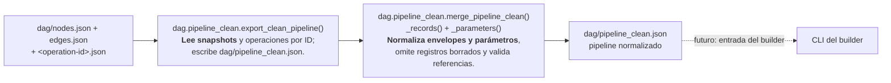
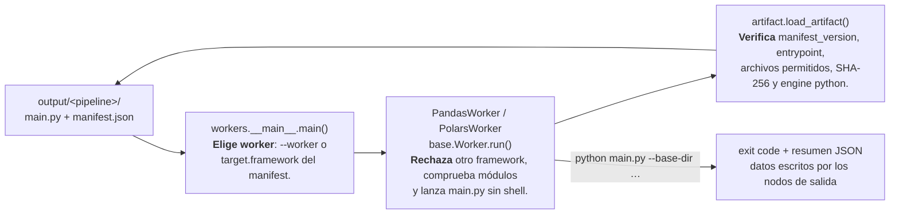

# Detalle de clases y funciones del generador

Este diagrama desglosa el código actual desde la entrada CLI hasta los archivos
generados. Cada componente indica su símbolo, responsabilidad y mecanismo. Las
rutas son relativas a `script-builder/src/script_builder/`.

## Flujo principal de compilación

```mermaid
flowchart LR
    PIPELINE["dag/pipeline_test.json<br/><b>Entrada por defecto</b><br/>nodes, edges, operation, parameters"]

    subgraph ENTRY["Entrada al compilador"]
        MAIN["script-builder/src/main.py<br/><b>Punto de entrada</b>: delega en el CLI."]
        CLI["script_builder.__main__.main()<br/><b>Lee argumentos</b>: pipeline, framework y metadata;<br/>por defecto output/&lt;pipeline&gt; y pipeline-id = nombre del JSON."]
        BUILD["script_builder.codegen.builder.build_artifact()<br/><b>Orquesta compilación</b>: crea plan,<br/>emite código y escribe el artefacto<br/>(overwrite=True desde el CLI)."]
        MAIN -->|"delegación"| CLI
        PIPELINE -->|"JSON leído por CLI"| CLI
        CLI -->|"pipeline + opciones"| BUILD
    end

    subgraph PLAN["Plan lógico · script_builder.ir"]
        BUILD_PLAN["script_builder.ir.plan.build_plan()<br/><b>Construye ExecutionPlan</b> sin leer datasets<br/>ni importar runtimes dataframe."]
        COLLECT["pipeline_graph.collect_nodes()<br/><b>Indexa nodos</b> declarados; si faltan,<br/>los recupera de los extremos de edges."]
        PORTS["plan._ports()<br/><b>Valida puertos</b>: IDs únicos,<br/>ordinales válidos y pertenencia."]
        ORDER["pipeline_graph.topological_order()<br/><b>Ordena dependencias</b> con DFS;<br/>rechaza aristas inválidas y ciclos."]
        CATALOG["OperationSpec + catalog.get_operation()<br/><b>Definen y resuelven</b> operación/alias;<br/>aridad, esquema JSON y frameworks."]
        VALIDATE["parameter_reference()<br/>validate_value()<br/>validate_constraints()<br/>validate_target_parameters()<br/><b>Comprueban</b> placeholders, esquema,<br/>reglas cruzadas y compatibilidad."]
        EXPRESSION["expressions.parse_expression()<br/><b>Analiza fx seguro</b> a AST allowlisted;<br/>no evalúa código arbitrario."]
        PLAN_OUT["ExecutionPlan<br/><b>Guarda</b> Steps ordenados, input bindings,<br/>outputs, datasources y runtime parameters."]

        BUILD -->|"pipeline + target"| BUILD_PLAN
        BUILD_PLAN --> COLLECT
        BUILD_PLAN --> PORTS
        BUILD_PLAN --> ORDER
        BUILD_PLAN --> CATALOG
        BUILD_PLAN --> VALIDATE
        BUILD_PLAN -.->|"solo para operación fx"| EXPRESSION
        COLLECT --> PLAN_OUT
        PORTS --> PLAN_OUT
        ORDER --> PLAN_OUT
        CATALOG --> PLAN_OUT
        VALIDATE --> PLAN_OUT
        EXPRESSION -.-> PLAN_OUT
    end

    subgraph EMISSION["Emisión · script_builder.codegen"]
        REGISTRY["codegen.registry.EMITTERS<br/><b>Selecciona clase emitter</b><br/>pandas o polars."]
        PANDAS["PandasEmitter.emit(plan)<br/><b>Genera módulo standalone</b>: imports,<br/>validación runtime, run() y CLI."]
        NATIVE["PolarsEmitter<br/><b>Especializa</b> mapping, imports,<br/>tipo de frame y operaciones Polars."]
        FX_RENDER["expressions.render_expression()<br/><b>Traduce AST</b> a expresiones nativas<br/>del framework seleccionado."]
        PANDAS_AST["pandas._helper_sources()<br/>_MethodToFunction<br/><b>Extraen helpers necesarios</b> de operations/&lt;framework&gt;;<br/>eliminan self y copian dependencias recursivas."]
        NATIVE_OPS["operations/polars<br/>módulos io / row / structural / date,<br/>conversion / logical / numeric / text<br/><b>Implementan</b> todo el catálogo Polars."]
        RUNTIME["codegen.runtime<br/>resolve_parameters(), step_parameters(),<br/>check_context(), script_main()<br/><b>Se copian al script</b> para resolver<br/>parámetros, validar inputs y exponer CLI."]
        SOURCE["Código fuente Python standalone<br/><b>run(datasources, parameters, base_dir)</b><br/>y bloque de ejecución CLI."]

        PLAN_OUT -->|"ExecutionPlan"| REGISTRY
        REGISTRY -->|"framework pandas"| PANDAS
        REGISTRY -->|"framework nativo"| NATIVE
        PANDAS --> PANDAS_AST
        NATIVE --> NATIVE_OPS
        PANDAS --> RUNTIME
        NATIVE --> RUNTIME
        PANDAS -.->|"nodo fx"| FX_RENDER
        NATIVE -.->|"nodo fx compatible"| FX_RENDER
        PANDAS_AST --> SOURCE
        NATIVE_OPS --> SOURCE
        RUNTIME --> SOURCE
        FX_RENDER -.-> SOURCE
    end

    subgraph ARTIFACT["Manifest y archivos · script_builder.artifacts"]
        NOTEBOOK["codegen.notebook.emit_notebook()<br/><b>Opcional</b>: empaqueta definiciones,<br/>inputs editables y celda de ejecución."]
        MANIFEST["artifacts.manifest.build_manifest()<br/>parameter_schema() + sha256()<br/><b>Describe target, hashes, parámetros,<br/>datasources, outputs y entrypoint.</b>"]
        WRITE["builder escribe archivos<br/><b>output_dir/main.py</b><br/><b>output_dir/manifest.json</b><br/>[output_dir/pipeline.ipynb]<br/>Reemplaza la carpeta si overwrite; manifest al final."]
        SOURCE -->|"script generado"| MANIFEST
        SOURCE -->|"si notebook=true"| NOTEBOOK
        NOTEBOOK -.->|"contenido opcional"| MANIFEST
        SOURCE -->|"main.py"| WRITE
        NOTEBOOK -.->|"pipeline.ipynb"| WRITE
        MANIFEST -->|"manifest.json"| WRITE
    end

    classDef input fill:#eaf3ff,stroke:#1565c0,color:#0d47a1;
    classDef component fill:#e8f5e9,stroke:#2e7d32,color:#1b5e20;
    classDef artifact fill:#fff3e0,stroke:#ef6c00,color:#e65100;
    class PIPELINE input;
    class MAIN,CLI,BUILD,BUILD_PLAN,COLLECT,PORTS,ORDER,CATALOG,VALIDATE,EXPRESSION,PLAN_OUT,REGISTRY,PANDAS,NATIVE,FX_RENDER,PANDAS_AST,NATIVE_OPS,RUNTIME,SOURCE,NOTEBOOK,MANIFEST component;
    class WRITE artifact;
```

## Qué hace cada parte

| Símbolo | Qué hace y cómo |
|---|---|
| `script-builder/src/main.py` | Punto de entrada; delega en `script_builder.__main__.main`. |
| `script_builder.__main__.main` | Lee el pipeline JSON (por defecto `dag/pipeline_test.json`) y sus opciones. Escribe por defecto en `output/<nombre-del-pipeline>/`, o en `--output-dir`. |
| `build_artifact` | Controla el orden de compilación y escritura. Sin `overwrite=True` no reemplaza un directorio existente. |
| `build_plan` | Valida y traduce JSON a IR independiente del runtime de datos. |
| `collect_nodes`, `_ports`, `topological_order` | Indexan nodos, comprueban puertos/aristas y ordenan productores antes que consumidores. |
| `OperationSpec`, `get_operation`, `compatibility_matrix` | Declaran aridad, esquema de parámetros y frameworks compatibles; resuelven alias de operación. |
| `parameter_reference`, `validate_value`, `validate_constraints`, `validate_target_parameters` | Detectan parámetros runtime y verifican esquema, reglas cruzadas y capacidades por framework. |
| `parse_expression`, `render_expression` | Convierte `fx` a una AST restringida y luego a sintaxis del backend; no usa `eval`. |
| `EMITTERS`, `PandasEmitter`, `PolarsEmitter` | Eligen backend y generan las llamadas explícitas por nodo junto con sus helpers mínimos. |
| `_helper_sources`, `_MethodToFunction` | Inspeccionan los métodos usados de `operations/pandas` u `operations/polars`, los convierten en funciones y siguen sus dependencias. |
| `PandasEmitter.implementations`, `PolarsOperations` | Enrutan cada operación del catálogo a su método Pandas (clase `*Operations` por categoría) o Polars. Las pruebas comprueban que cubren el catálogo completo. |
| `step_parameters`, `check_context`, `script_main` | Se incluyen en el script para validar inputs y parámetros de ejecución, leer archivos de argumentos y ejecutar `run()`. |
| `emit_notebook` | Genera tres celdas reproducibles: definiciones, inputs configurables y ejecución; no reemplaza `main.py`. |
| `build_manifest`, `parameter_schema`, `sha256` | Construyen metadatos de runtime y calculan los hashes del plan y archivos emitidos. |

## Normalización de respuestas API (desconectada)

`merge_pipeline_clean` **no se llama** desde `build_artifact` ni desde el CLI.
Mientras no exista la captura desde la API, el builder usa
`dag/pipeline_test.json`.

## Worker emulado · workers/src/workers

## Artefacto resultante

`output/<pipeline>/` contiene:

- Un `main.py` autónomo para el framework seleccionado.
- Un `manifest.json` con perfil y hashes.
- `pipeline.ipynb`, si se solicita.

El worker solo necesita el runtime del manifest (`pandas`/`numpy` o `polars`).
No necesita el catálogo, los emitters ni el resto de este repositorio.
