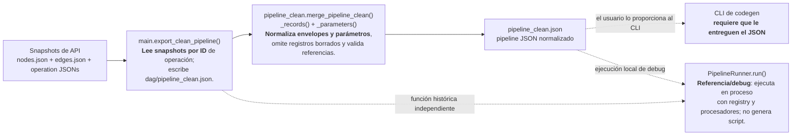

# Detalle de clases y funciones del generador

Este diagrama desglosa el código actual desde la entrada CLI hasta los archivos
generados. Cada componente indica su símbolo, responsabilidad y mecanismo.

## Flujo principal de compilación

```mermaid
flowchart LR
    PIPELINE["Pipeline JSON normalizado<br/><b>Entrada</b><br/>nodes, edges, operation, parameters"]

    subgraph ENTRY["Entrada al compilador"]
        MAIN["main.py · bloque __main__<br/><b>Selecciona</b> el CLI del generador."]
        CLI["engine.codegen.__main__.main()<br/><b>Lee argumentos</b>: pipeline, target y metadata;<br/>usa output/&lt;pipeline&gt; si se omite output-dir."]
        BUILD["engine.codegen.builder.build_artifact()<br/><b>Orquesta compilación</b>: crea plan,<br/>emite código y escribe el artefacto."]
        MAIN -->|"delegación"| CLI
        PIPELINE -->|"JSON leído por CLI"| CLI
        CLI -->|"pipeline + opciones"| BUILD
    end

    subgraph PLAN["Plan lógico · engine.ir"]
        BUILD_PLAN["engine.ir.plan.build_plan()<br/><b>Construye ExecutionPlan</b> sin leer datasets<br/>ni importar runtimes dataframe."]
        COLLECT["pipeline_graph.collect_nodes()<br/><b>Indexa nodos</b> declarados; si faltan,<br/>los recupera de los extremos de edges."]
        PORTS["plan._ports()<br/><b>Valida puertos</b>: IDs únicos,<br/>ordinales válidos y pertenencia."]
        ORDER["pipeline_graph.topological_order()<br/><b>Ordena dependencias</b> con DFS;<br/>rechaza aristas inválidas y ciclos."]
        CATALOG["OperationSpec + catalog.get_operation()<br/><b>Definen y resuelven</b> operación/alias;<br/>aridad, esquema JSON y frameworks."]
        VALIDATE["parameter_reference()<br/>validate_value()<br/>validate_constraints()<br/>validate_target_parameters()<br/><b>Comprueban</b> placeholders, esquema,<br/>reglas cruzadas y compatibilidad."]
        EXPRESSION["expressions.parse_expression()<br/><b>Analiza fx seguro</b> a AST allowlisted;<br/>no evalúa código arbitrario."]
        PLAN_OUT["ExecutionPlan<br/><b>Guarda</b> Steps ordenados, input bindings,<br/>outputs, datasources y runtime parameters."]

        BUILD -->|"pipeline + target"| BUILD_PLAN
        BUILD_PLAN --> COLLECT
        BUILD_PLAN --> PORTS
        BUILD_PLAN --> ORDER
        BUILD_PLAN --> CATALOG
        BUILD_PLAN --> VALIDATE
        BUILD_PLAN -.->|"solo para operación fx"| EXPRESSION
        COLLECT --> PLAN_OUT
        PORTS --> PLAN_OUT
        ORDER --> PLAN_OUT
        CATALOG --> PLAN_OUT
        VALIDATE --> PLAN_OUT
        EXPRESSION -.-> PLAN_OUT
    end

    subgraph EMISSION["Emisión · engine.codegen"]
        REGISTRY["codegen.registry.EMITTERS<br/><b>Selecciona clase emitter</b><br/>según framework: pandas, polars,<br/>pyarrow o pyspark."]
        PANDAS["PandasEmitter.emit(plan)<br/><b>Genera módulo standalone</b>: imports,<br/>validación runtime, run() y CLI."]
        NATIVE["PolarsEmitter / PyArrowEmitter / PySparkEmitter<br/><b>Especializan</b> mapping, imports,<br/>tipo de frame y operaciones nativas."]
        FX_RENDER["expressions.render_expression()<br/><b>Traduce AST</b> a expresiones nativas<br/>del framework seleccionado."]
        PROCESSOR_AST["pandas._helper_sources()<br/>_MethodToFunction<br/><b>Extraen helpers necesarios</b> de processors;<br/>eliminan self y copian dependencias recursivas."]
        NATIVE_OPS["codegen.native_ops<br/>PolarsOps / ArrowOps / SparkOps<br/><b>Implementan</b> operaciones nativas<br/>que se copian al script generado."]
        RUNTIME["codegen.runtime<br/>resolve_parameters(), step_parameters(),<br/>check_context(), script_main()<br/><b>Se copian al script</b> para resolver<br/>parámetros, validar inputs y exponer CLI."]
        SOURCE["Código fuente Python standalone<br/><b>run(datasources, parameters, base_dir)</b><br/>y bloque de ejecución CLI."]

        PLAN_OUT -->|"ExecutionPlan"| REGISTRY
        REGISTRY -->|"framework pandas"| PANDAS
        REGISTRY -->|"framework nativo"| NATIVE
        PANDAS --> PROCESSOR_AST
        NATIVE --> NATIVE_OPS
        PANDAS --> RUNTIME
        NATIVE --> RUNTIME
        PANDAS -.->|"nodo fx"| FX_RENDER
        NATIVE -.->|"nodo fx compatible"| FX_RENDER
        PROCESSOR_AST --> SOURCE
        NATIVE_OPS --> SOURCE
        RUNTIME --> SOURCE
        FX_RENDER -.-> SOURCE
    end

    subgraph ARTIFACT["Manifest y archivos · engine.artifacts"]
        NOTEBOOK["codegen.notebook.emit_notebook()<br/><b>Opcional</b>: empaqueta definiciones,<br/>inputs editables y celda de ejecución."]
        MANIFEST["artifacts.manifest.build_manifest()<br/>parameter_schema() + sha256()<br/><b>Describe target, hashes, parámetros,<br/>datasources, outputs y entrypoint.</b>"]
        WRITE["builder escribe archivos<br/><b>output_dir/main.py</b><br/><b>output_dir/manifest.json</b><br/>[output_dir/pipeline.ipynb]<br/>Crea directorio exclusivo; manifest al final."]
        SOURCE -->|"script generado"| MANIFEST
        SOURCE -->|"si notebook=true"| NOTEBOOK
        NOTEBOOK -.->|"contenido opcional"| MANIFEST
        SOURCE -->|"main.py"| WRITE
        NOTEBOOK -.->|"pipeline.ipynb"| WRITE
        MANIFEST -->|"manifest.json"| WRITE
    end

    classDef input fill:#eaf3ff,stroke:#1565c0,color:#0d47a1;
    classDef component fill:#e8f5e9,stroke:#2e7d32,color:#1b5e20;
    classDef artifact fill:#fff3e0,stroke:#ef6c00,color:#e65100;
    class PIPELINE input;
    class MAIN,CLI,BUILD,BUILD_PLAN,COLLECT,PORTS,ORDER,CATALOG,VALIDATE,EXPRESSION,PLAN_OUT,REGISTRY,PANDAS,NATIVE,FX_RENDER,PROCESSOR_AST,NATIVE_OPS,RUNTIME,SOURCE,NOTEBOOK,MANIFEST component;
    class WRITE artifact;
```

## Qué hace cada parte

| Símbolo | Qué hace y cómo |
|---|---|
| `main.py` (`__main__`) | En ejecución CLI, delega a `engine.codegen.__main__.main`; no ejecuta el runner histórico. |
| `engine.codegen.__main__.main` | Lee el pipeline JSON y opciones. El output por defecto es `output/<nombre-del-pipeline>/`; `--output-dir` lo puede reemplazar. |
| `build_artifact` | Controla el orden de compilación y escritura; no sobrescribe un directorio ya existente. |
| `build_plan` | Valida y traduce JSON a IR independiente del runtime de datos. |
| `collect_nodes`, `_ports`, `topological_order` | Indexan nodos, comprueban puertos/aristas y ordenan productores antes que consumidores. |
| `OperationSpec`, `get_operation`, `compatibility_matrix` | Declaran aridad, esquema de parámetros y frameworks compatibles; resuelven alias de operación. |
| `parameter_reference`, `validate_value`, `validate_constraints`, `validate_target_parameters` | Detectan parámetros runtime y verifican esquema, reglas cruzadas y capacidades por framework. |
| `parse_expression`, `render_expression` | Convierte `fx` a una AST restringida y luego a sintaxis del backend; no usa `eval`. |
| `EMITTERS`, `PandasEmitter`, emitters nativos | Eligen backend y generan las llamadas explícitas por nodo junto con sus helpers mínimos. |
| `_helper_sources`, `_MethodToFunction` | En pandas inspeccionan métodos locales permitidos, los convierten de métodos de instancia a funciones y siguen dependencias necesarias. |
| `PolarsOps`, `ArrowOps`, `SparkOps` | Proveen implementaciones nativas para los emitters de Polars, PyArrow y PySpark. |
| `step_parameters`, `check_context`, `script_main` | Se incluyen en el script para validar inputs y parámetros de ejecución, leer archivos de argumentos y ejecutar `run()`. |
| `emit_notebook` | Genera tres celdas reproducibles: definiciones, inputs configurables y ejecución; no reemplaza `main.py`. |
| `build_manifest`, `parameter_schema`, `sha256` | Construyen metadatos de runtime y calculan los hashes del plan y archivos emitidos. |

## Normalización y runner de referencia (fuera del camino automático)

`merge_pipeline_clean` **no se llama automáticamente** desde `build_artifact` ni
desde el CLI. La integración con API/DataIntegration debe invocar la limpieza o
entregar directamente un pipeline normalizado. `PipelineRunner` y
`operation_registry` se mantienen como referencia para pruebas/debug; el código
generado contiene sus propios helpers y no importa esos módulos.

## Artefacto resultante

El directorio `output/<pipeline>/` contiene un `main.py` autónomo para el
framework seleccionado, un `manifest.json` con perfil y hashes y, si se solicita,
`pipeline.ipynb`. El worker necesita el runtime del manifest, pero no el catálogo,
los emitters ni el resto de este repositorio.
