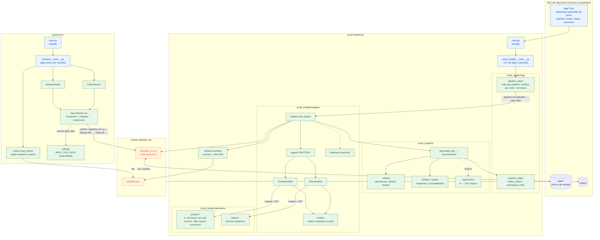
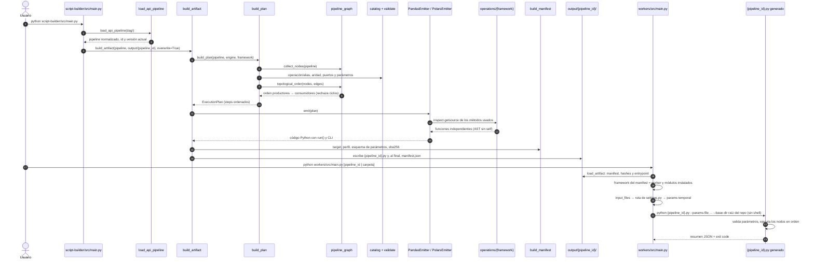

# Flujo interno del repositorio

El repositorio tiene dos partes independientes:

- `script-builder/src`: lee un DAG y genera el script.
- `workers/src`: emula los workers que ejecutan ese script.

Este documento describe sus módulos y el flujo completo desde las respuestas
de la API guardadas en `dag/` hasta la ejecución del script. No se consulta
ningún endpoint: solo se leen esos JSON.

## Componentes del repositorio



## Secuencia: del DAG al script ejecutado



## Qué ocurre en cada etapa

1. **Entrada:** `python script-builder/src/main.py` llama a
   `script_builder.__main__.main`. Por defecto lee la carpeta `dag/` con
   `load_api_pipeline`, que clasifica cada respuesta por su `code`, filtra por la
   versión actual y normaliza nodos, aristas y parámetros. Escribe en
   `output/<pipeline_id>/`. Cada ejecución reemplaza esa carpeta.
2. **Nodos y aristas:** `build_plan` (`ir/plan.py`) obtiene los nodos con
   `collect_nodes` y las aristas de `pipeline["edges"]`.
3. **DAG y validación:** `build_plan` comprueba lo siguiente:
   - Puertos, ordinales y que cada arista pertenezca a sus nodos.
   - Operación y alias (`catalog`), aridad y parámetros (`validate`).
   - Compatibilidad con el framework (`targets`).

   `topological_order` rechaza ciclos y fija el orden de ejecución. El resultado
   es un `ExecutionPlan` independiente del framework.
4. **Script:** `EMITTERS[framework]` elige el emitter. El emitter copia al
   script, como funciones independientes, solo los métodos de
   `operations/<framework>/` que usa el DAG, más los helpers de `runtime`.
   Genera una llamada por nodo dentro de `run()` y una CLI. El script no importa
   `script_builder`.
5. **Manifest:** `build_manifest` registra target, perfil, dependencias, el
   esquema de parámetros, los puertos externos, los nodos terminales y los
   hashes. Se escribe al final como marca de que la generación terminó.
6. **Worker:** `load_artifact` verifica el manifest y los hashes. El worker del
   framework indicado comprueba sus módulos, resuelve las rutas de `input_files`
   con `workers/src/workers/settings.py` y ejecuta
   `python <pipeline_id>.py --params-file … --datasources-file … --base-dir …` en un
   subproceso sin shell. Devuelve el exit code.

## `pipeline_clean`

`script_builder.dag.pipeline_clean` convierte las respuestas de la API guardadas
en `dag/` (`PIPELINE_RETRIEVED`, `PIPELINE_NODES_LIST_RETRIEVED`,
`PIPELINE_EDGES_LIST_RETRIEVED`, `OPERATION_RETRIEVED`) en un pipeline
normalizado. El nombre del archivo no importa; los vacíos y los `code`
desconocidos se ignoran. El parámetro `archivo` (ID de archivo) se convierte en
el parámetro de ejecución `file_<id>`, listado en `input_files` del manifest; el
worker le asigna la ruta de `settings.py`. Un `write_csv` sin ruta escribe en
`output/<pipeline_id>/<node_id>.csv`. `export_clean_pipeline("dag")` guarda el
resultado en `dag/pipeline_clean.json` solo para inspección.

## Comandos

```bash
python script-builder/src/main.py                     # pandas → output/<pipeline_id>/<pipeline_id>.py
python script-builder/src/main.py --framework polars
python workers/src/main.py                            # ejecuta el último artefacto generado
python workers/src/main.py <pipeline_id>              # o una carpeta de artefacto
```
