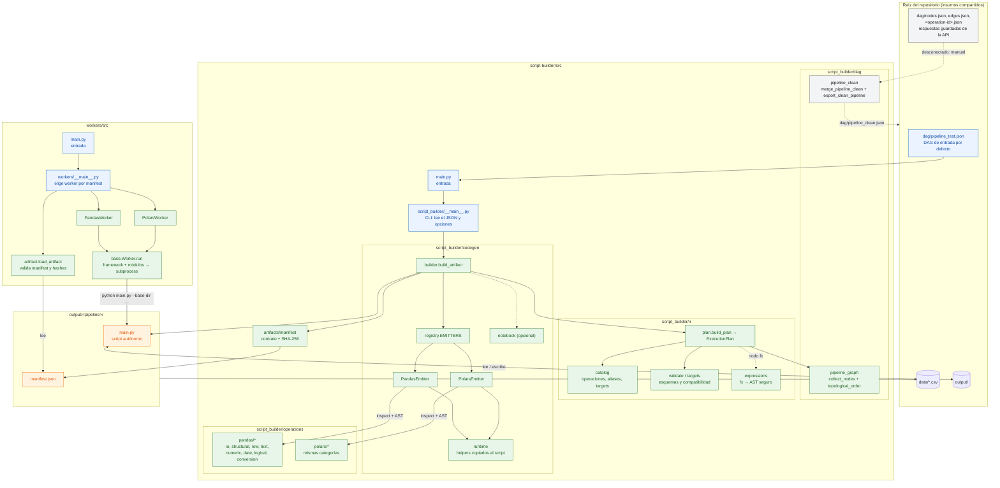
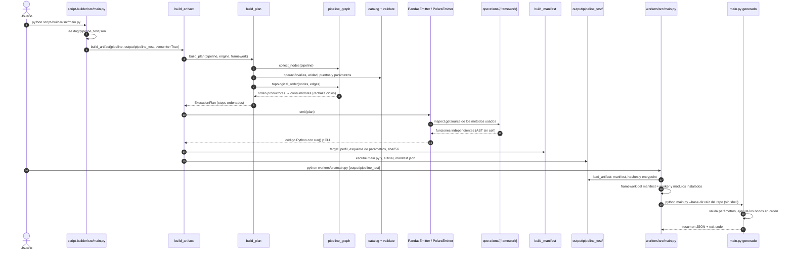

# Flujo interno del repositorio

El repositorio tiene dos partes independientes:

- `script-builder/src`: lee un DAG y genera el script.
- `workers/src`: emula los workers que ejecutan ese script.

Este documento describe sus módulos y el flujo completo desde
`dag/pipeline_test.json` hasta la ejecución del script.

## Componentes del repositorio



## Secuencia: del DAG al script ejecutado



## Qué ocurre en cada etapa

1. **Entrada:** `python script-builder/src/main.py` llama a
   `script_builder.__main__.main`. Por defecto lee `dag/pipeline_test.json` y
   escribe en `output/<nombre-del-JSON>/`. Cada ejecución reemplaza esa carpeta.
2. **Nodos y aristas:** `build_plan` (`ir/plan.py`) obtiene los nodos con
   `collect_nodes` y las aristas de `pipeline["edges"]`.
3. **DAG y validación:** `build_plan` comprueba lo siguiente:
   - Puertos, ordinales y que cada arista pertenezca a sus nodos.
   - Operación y alias (`catalog`), aridad y parámetros (`validate`).
   - Compatibilidad con el framework (`targets`).

   `topological_order` rechaza ciclos y fija el orden de ejecución. El resultado
   es un `ExecutionPlan` independiente del framework.
4. **Script:** `EMITTERS[framework]` elige el emitter. El emitter copia al
   script, como funciones independientes, solo los métodos de
   `operations/<framework>/` que usa el DAG, más los helpers de `runtime`.
   Genera una llamada por nodo dentro de `run()` y una CLI. El script no importa
   `script_builder`.
5. **Manifest:** `build_manifest` registra target, perfil, dependencias, el
   esquema de parámetros, los puertos externos, los nodos terminales y los
   hashes. Se escribe al final como marca de que la generación terminó.
6. **Worker:** `load_artifact` verifica el manifest y los hashes. El worker del
   framework indicado comprueba sus módulos y ejecuta
   `python main.py --params-file … --datasources-file … --base-dir …` en un
   subproceso sin shell. Devuelve el exit code.

## `pipeline_clean` (desconectado)

`script_builder.dag.pipeline_clean` convierte las respuestas de la API
(`nodes`, `edges`, `operation`) en un pipeline normalizado. Hoy **no forma parte
del flujo principal**. Se ejecuta a mano con `export_clean_pipeline("dag")`,
que escribe `dag/pipeline_clean.json`. Los snapshots actuales compilan y se
ejecutan en Pandas y Polars usando `dag/pipeline_clean_datasources.json` para
los tres puertos externos. Cuando exista la captura
de la API, su salida será la entrada de `build_artifact`.
El DAG termina en el nodo `guardar_csv` (`write_csv`), conectado a la salida de
`avg`, y el worker escribe el resultado agregado en
`output/segment_sales_by_segment.csv` relativo a la raíz del repositorio.

## Comandos

```bash
python script-builder/src/main.py                                   # pandas → output/pipeline_test/
python script-builder/src/main.py --framework polars --output-dir output/pipeline_test_polars
python workers/src/main.py                                          # ejecuta output/pipeline_test
python workers/src/main.py output/pipeline_test_polars              # worker polars (según manifest)
```

El contexto con la UI/API, Kafka, el Job Dispatcher y Kubernetes está en el
[diagrama de arquitectura](ARCHITECTURE_DAG_SCRIPT_BUILDER.md).
