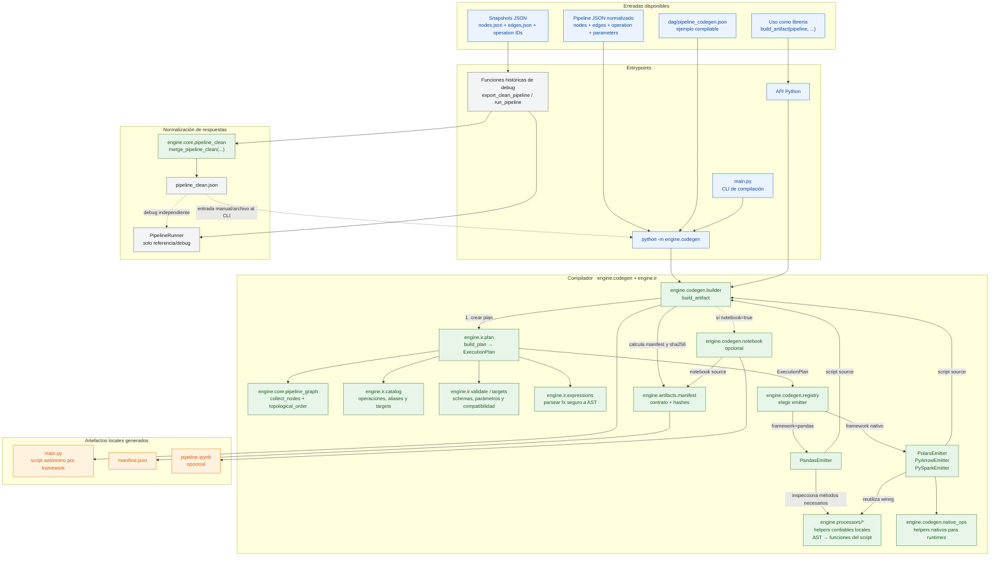
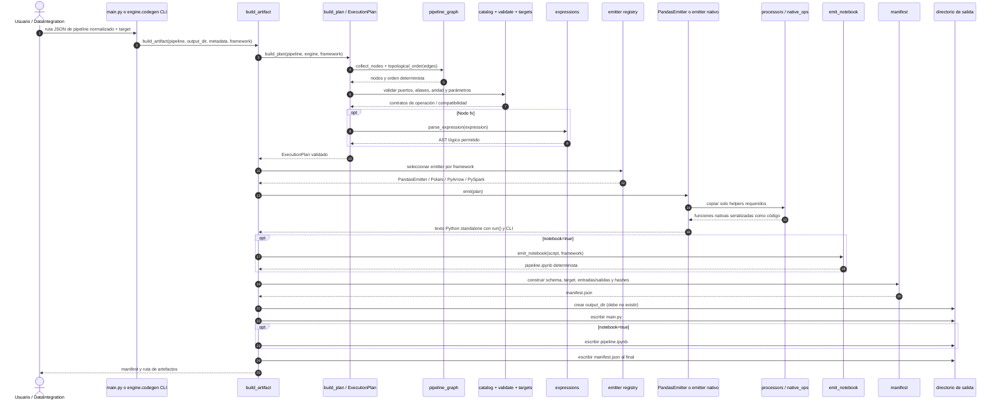

# Flujo interno del repositorio

Este documento describe los módulos que existen en este repositorio y el flujo
actual para compilar un DAG y generar un script ejecutable.

## Componentes del repositorio



## Secuencia de compilación y generación



## Qué ocurre en cada etapa

1. **Entrada:** `python main.py <pipeline.json> ...` delega en el CLI de
   `engine.codegen`. También se puede llamar directamente a
   `engine.codegen.builder.build_artifact`. En ambos casos el pipeline se
   entrega como JSON con nodos, aristas, operaciones y parámetros. Si no se
   especifica `--output-dir`, la CLI usa `output/<nombre-del-JSON>/`.
2. **Plan lógico:** `build_plan` no carga datasets ni importa pandas/Polars/Spark.
   `pipeline_graph` valida referencias de nodos y calcula el orden topológico.
   `catalog`, `validate` y `targets` verifican nombres/aliases de operaciones,
   número de entradas, puertos, parámetros y soporte en el framework destino.
3. **Expresiones:** si el pipeline contiene `fx`, la expresión se analiza con
   una gramática limitada y se almacena como AST lógico. El emitter la renderiza
   como expresión del framework elegido; no se ejecuta código Python arbitrario
   ni `eval`.
4. **Selección del backend:** `engine.codegen.registry` selecciona un emitter
   para `pandas`, `polars`, `pyarrow` o `pyspark`. La matriz de compatibilidad
   rechaza durante la planificación las operaciones que el destino no soporta.
5. **Emisión del código:** el emitter crea llamadas explícitas por nodo, wiring
   de inputs/outputs, validación de parámetros runtime, `run(...)` y una CLI.
   Para pandas extrae del AST los métodos/helper confiables necesarios desde
   `engine.processors`; para los runtimes nativos usa implementaciones de
   `engine.codegen.native_ops`. El artefacto no importa este repositorio.
6. **Manifest y escritura:** se calcula SHA-256 del plan y de los archivos.
   El directorio de salida se crea en modo exclusivo: si ya existe, la
   compilación falla en lugar de sobrescribir artefactos. El manifest se escribe
   al final como marca de que la generación concluyó.
7. **Notebook opcional:** `--notebook` añade un notebook determinista con
   definiciones, celdas para parámetros/datasources y ejecución. El entrypoint
   principal del worker sigue siendo `main.py`.

## Límite actual con `pipeline_clean`

`engine.core.pipeline_clean.merge_pipeline_clean` normaliza snapshots de
respuestas `nodes`, `edges` y `operations`. En el estado actual es invocado por
las funciones históricas de debug de `main.py`; **no se llama automáticamente
dentro de `build_artifact` ni del CLI de compilación**. Por tanto, el caller
debe proporcionar a `build_artifact` un pipeline que ya esté en el formato
normalizado esperado. La conexión directa API → cleaner → builder queda como
integración del plano DataIntegration pendiente.

El `PipelineRunner`, `operation_registry` y los procesadores son referencia de
ejecución local y soporte del código confiable que reutiliza el emitter; no son
dependencias del script generado ni del worker que lo ejecuta.

## Comandos

```bash
# Compilar desde un pipeline JSON normalizado
python main.py dag/pipeline_codegen.json \
  --pipeline-id orders --pipeline-version 1

# Elegir explícitamente otra carpeta de artefactos
python main.py dag/pipeline_codegen.json \
  --output-dir /tmp/orders-pandas \
  --pipeline-id orders --pipeline-version 1

# Seleccionar otro backend y generar notebook adicional
python -m engine.codegen dag/pipeline_codegen.json \
  --output-dir /tmp/orders-polars \
  --pipeline-id orders --pipeline-version 1 \
  --framework polars --notebook
```

El resultado es un artefacto con `main.py`, `manifest.json` y, de solicitarse,
`pipeline.ipynb`. Este diagrama termina en la generación del artefacto; la
publicación, Kafka, Job Dispatcher y ejecución de workers están descritos en el
[diagrama de arquitectura de integración](ARCHITECTURE_DAG_SCRIPT_BUILDER.md).
Sin `--output-dir`, el ejemplo genera los archivos en
`output/pipeline_codegen/`; como el artefacto es inmutable, esa carpeta debe no
existir antes de compilar.
